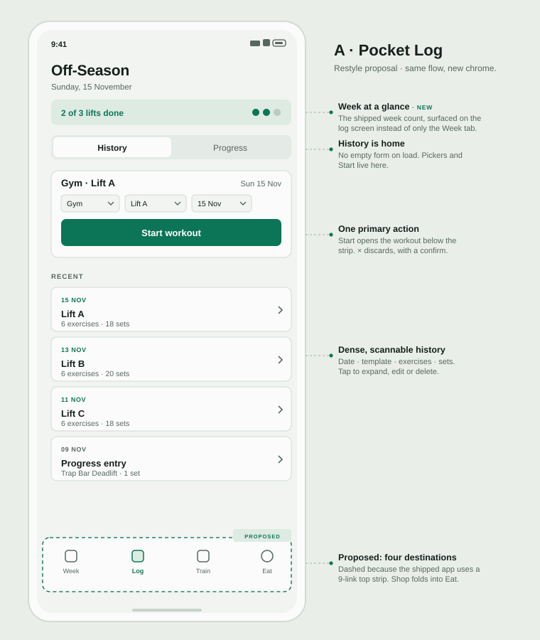
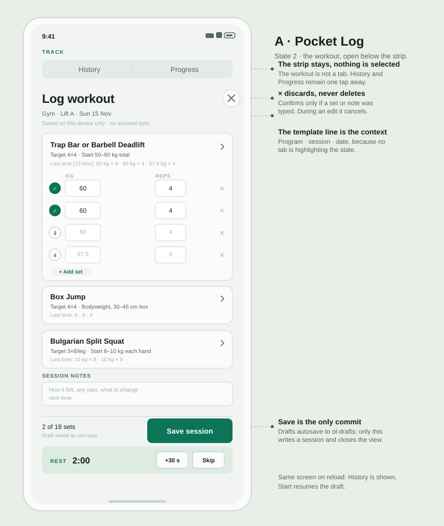
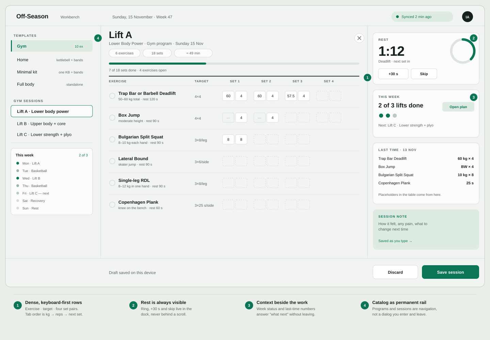
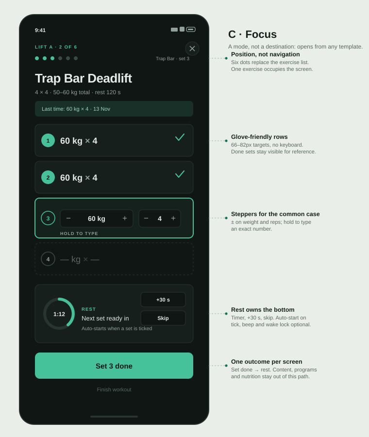
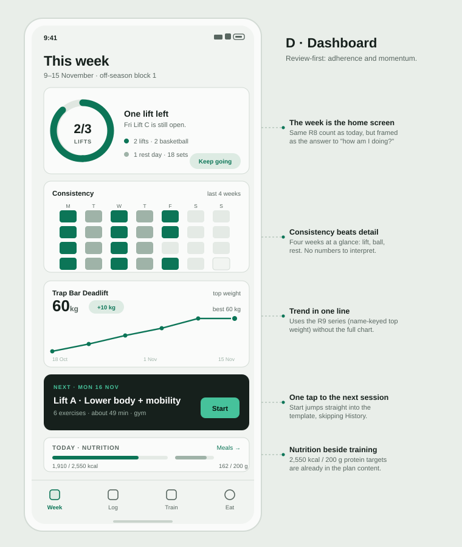

# UI templates

Four layouts for the same contract, each as an annotated wireframe using real
catalog data. Open **`index.html`** for the gallery, or view the SVGs directly.

```bash
python3 -m http.server 8080   # from the repo root
# http://localhost:8080/contract/templates/
```

Machine-readable summaries, scores and rule requirements: `templates.json`.

Pocket Log keeps the shipped flow with restyled chrome; dashed outlines and "proposal" badges mark changes to review. The literal current screens are kept as `*-shipped.svg` references.

| | Template | Viewport | Home | Effort | Best for |
|---|---|---|---|---|---|
| **A** | [Pocket Log](pocket-log.svg) | Phone | Week | Low | Gym, one hand, existing users |
| **B** | [Workbench](workbench.svg) | Desktop / tablet | Active session | Medium | Laptop/tablet, fast correction |
| **C** | [Focus](focus.svg) | Phone | Exercise *n* of 6 | Low | Mid-set, gloves, no decisions |
| **D** | [Dashboard](dashboard.svg) | Phone / desktop | This week | Medium | Adherence and momentum |

---

## A · Pocket Log



History stays the home of the log tab. Template pickers and **Start workout**
live there; the workout opens below the sub-tab strip and disappears on save or
discard. The five nav groups become four destinations.



Second state: no tab is selected while the workout is open. The template line
carries the context, × discards (cancelling an edit instead of deleting), and
the save bar is the only path into History.

**It is a restyle proposal**, not a screenshot. The flow is the shipped one;
the chrome is new: segmented History/Progress, card rows, a week pill on the log
screen, and a proposed four-destination bottom nav. The nav is hidden while a
workout is open, so the workout state is drawn without it. For the literal
current screens, captured from the running app at 390×844, see
[History, as shipped](pocket-log-shipped.svg) and
[workout, as shipped](pocket-log-workout-shipped.svg).

**Pick it when** you want the current flow with cleaner chrome and a shorter
nav, and you are willing to accept a visual redesign of the log screen. It is
the only template that keeps every surface in its current place.

**Needs:** all log rules (R1–R16), including start/discard (R16). **Watch:** the week status is still a thin
strip, and content competes with training for attention.

---

## B · Workbench



Catalog on the left, the session as a dense editable table in the middle, and a
dock on the right for rest, week status and last time. Keyboard tab order runs
kg → reps → next set.

**Pick it when** the primary device is a laptop or a tablet propped up at home,
and you correct numbers more often than you browse content.

**Needs:** R1–R9, R11–R13, R16. **Watch:** the table is the hardest piece to make
accessible; give every input a real label (exercise + set + unit).

---

## C · Focus



A mode, not a destination. One exercise fills the screen; done sets stay
visible, the current set uses steppers, and the rest timer owns the bottom.
Entered automatically when a workout starts and left with "Finish workout".

**Pick it when** the other templates feel fiddly mid-set. It pairs with any of
them: Pocket Log or Workbench owns navigation, Focus owns the 40 minutes of
lifting.

**Needs:** R1–R4, R7, R11, R13. **Watch:** steppers must have a type fallback
for 57.5 kg and odd rep ranges; no way to browse the session ahead.

---

## D · Dashboard



The week becomes the home screen: completion ring, four-week consistency grid,
a one-line top-weight trend, the next session and nutrition targets. Logging is
one tap away, not the starting point.

**Pick it when** the goal shifts from "record the workout" to "stay consistent
for twelve weeks".

**Needs:** R1, R4, R8, R9. **Watch:** it is the weakest place to actually type a
workout, and trend cards are noise until three or four sessions exist.

---

## Recommendation

**Ship A, add C, lay out B at the wide breakpoint.**

- A is the lowest-risk base: same rules, same surfaces, four destinations.
- C is a small, additive mode that fixes the worst moment of the current UI —
  logging a heavy set one-handed.
- B is not a second app; it is the same session/table/rest components in a
  three-pane layout at `min-width: 56rem`.
- D is a different bet about what the product is for. Build it after the log is
  stable and there is enough data to fill a trend line.

If you must choose one: **B** for a tablet-at-home lifter, **A** for a
phone-at-the-gym lifter.

## Shared component inventory

Reusable regardless of template:

| Component | Reads | Rules |
|---|---|---|
| Session runner (pick program/session/date, start) | `catalog.json`, `ol-plan` | R1, R2 |
| Set row / grid | `ol-drafts`, last-time lookup | R3, R7, R13 |
| Save / discard bar | `ol-sessions` | R4, R5, R6 |
| Rest timer | `catalog.restTimes` | R11 |
| Week status | `ol-sessions` | R8 |
| Trend / chart | `ol-sessions` | R9 |
| Backup and sync | `ol-sync`, backup file | R14, R15 |

## Accessibility notes that apply to all four

- Set inputs need explicit labels: exercise, set number, kg vs reps vs seconds.
- Tick buttons need `aria-pressed`; the rest timer needs a live region, but do
  not announce every second — announce at 10 s, 3, 2, 1.
- Colour is never the only signal: done sets also carry a check mark, the
  consistency grid also reads as a list of dates in text.
- Steppers need keyboard equivalents and a text input fallback.
- Keep the 44 px minimum target; Focus uses 56–82 px deliberately.

## How the mockups were made

Hand-written SVG, 390 × 844 for phones, 1440 × 828 for the workbench, with the
phone or app rendered at 1× and annotations in the margin. Labels and numbers
come from `data/catalog.json` so they match the real program (Trap Bar Deadlift
4×4, 50–60 kg, rest 120 s, and so on).

The `*-shipped.svg` files are reference captures of the running app, reproduced
from headless-Chrome screenshots at 390 × 844. They are the ground truth for
the two Pocket Log states; the polished files are the redesign proposal.

To export a PNG for a slide deck:

```bash
"/Applications/Google Chrome.app/Contents/MacOS/Google Chrome" \
  --headless --window-size=1440,1000 --screenshot=workbench.png \
  "file://$PWD/contract/templates/workbench.svg"
```

These are illustrations, not generated from the contract. If the catalog
changes, update the numbers by hand; the structure and rules in
`../SPEC.md` are what stays authoritative.
